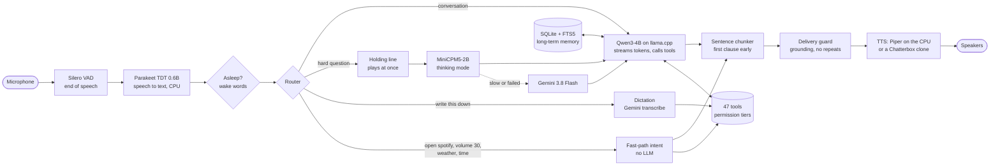

# Local AI Assistant AJ: a local, real-time voice assistant

AJ is a voice assistant that runs **entirely on a Windows gaming laptop**. You talk; it starts answering in about a second. It's fast, it's private, and it runs on a 6 GB laptop GPU. You call it "AJ" or "Computer".

**It can:**
- control the laptop with 47 permission-gated tools
- type what you say wherever your cursor is (dictation), in the assistant or in its own small window, AJ (Speak)
- sleep in the tray and wake when it hears its name, or when you clap twice
- remember you between sessions
- hand hard questions to a second reasoning model
- fall back to Gemini only when local models can't help

It talks in the manner of JARVIS from the Iron Man films: composed, polite and dryly witty, calling you "sir", with the answer first, exact numbers, humor at a level you set by voice, and honesty fixed at 100 percent.

> **Demo:** _60-second video coming soon_

---

## Highlights

- **~1.1–1.4 s from end of speech to first sound**, with every stage local and streaming. Its cloud-API predecessor took ~2.5 s.
- **137 ms median / 241 ms p95** to the LLM's first sentence, with prompt caching on llama.cpp.
- **Two cooperating local models:**
  - Qwen3-4B answers and talks.
  - MiniCPM5-2B in thinking mode solves the hard ones: 12/12 vs 10/12 on a hard-reasoning set.
  - Gemini 3.8 Flash is the last fallback.
- **Fits a 6 GB GPU and 16 GB of RAM** alongside everyday apps. Tuning llama.cpp cut its RAM from 2.8 GB to 0.75 GB.
- **47 laptop tools** behind a fail-closed permission dispatcher, with audit logging.
- **Dictation that never sends:** Gemini writes down what you say and AJ types it with real key presses where your cursor is. It never presses Enter or Send.
- **Long-term memory** in SQLite + FTS5, recalled in ~0.5 ms per turn and learned in the background only when idle.
- **Grounding guardrail:** a sentence that states facts about the user or device that nobody told the model is dropped before it's spoken.
- **A CPU voice:** Piper, with no graphics memory used and ready in under 2 s. Chatterbox Turbo voice cloning stays available for a bigger GPU.
- **1,099 automated tests**, plus live checks of every tool and of the model's tool use on the real laptop ([docs/TESTING.md](docs/TESTING.md)).

## How it works



Every stage overlaps. Speech-to-text runs as soon as the voice detector hears you stop. The LLM streams tokens. The voice starts on the first clause while the model is still writing the rest.

**Three routes per turn:**
1. **Instant commands.** Regex intents run tools with no model call at all.
2. **Hard questions.** A cached holding line plays at once while the reasoning model works. Qwen then voices the verified answer, with the facts intact.
3. **Conversation.** Qwen streams a reply and can call tools mid-turn.

## Measured results

Measured on an RTX 4050 Laptop GPU (6 GB), a Ryzen 7 7840HS and 16 GB of RAM, under Windows 11.

| Model (llama.cpp) | First sentence, cached (p50 / p95) | Laptop commands correct | Memory-extraction recall | RAM / VRAM |
|---|---|---|---|---|
| **Qwen3-4B-Instruct-2507 (GPU)**, chosen | **137 / 241 ms** | **91.7%** | **78%** | 0.78 / 3.1 GB |
| Gemma 4 E4B (GPU) | 251 / 376 ms | 91.7% | 47% | 3.4 / 3.0 GB |
| Hermes-3 3B (GPU) | 211 / 361 ms | 20% | 78% | 1.5 / 2.5 GB |
| Qwen3-4B (CPU) | 991 / 1629 ms | 91.7% | 76% | 2.8 GB / – |
| Qwen3-1.7B (CPU) | 546 / 1180 ms | 21.7% | 51% | 2.4 GB / – |

The final pick was confirmed with a **blind A/B listening test** of the persona.

**Hard-reasoning set** (12 tasks with checkable answers):

| Model | Correct | Median time |
|---|---|---|
| Qwen3-4B | 10/12 | 2.7 s |
| MiniCPM5-2B, thinking mode | **12/12** | 4.0 s |

The thinker loads on demand in 1.6 s.

**Speech:**
- Parakeet int8 on the CPU transcribes 1–3 s utterances in 118–243 ms.
- Piper (the default voice: "Obadiah", a British male picked by ear from 17, and the steadiest of them from one spoken piece to the next) runs on the CPU, starts a sentence in about 0.1 s and is ready in under 2 s.
- Kokoro, the earlier voice, rendered a first sentence in 387 ms on the GPU (1,057 ms on the CPU). Its model was removed; the code stays.
- Chatterbox Turbo runs at ~1.4× real time, using 5.8 of 6.1 GB of graphics memory alongside Qwen.
- Dictation, on test sentences with names, numbers and spoken punctuation: gemini-3.5-transcribe answered in a median 1.8 s with a 13% word error rate, against 23% for Parakeet.

## Features

- **Voice loop:**
  - VAD endpointing that waits longer when you trail off on "and…" or "um…"
  - talk over it through the laptop speakers and it stops and listens: its own echo is told apart from your voice
  - per-stage latency shown for every turn
- **Laptop control (47 tools):**
  - **apps:** open, switch, close, from a pre-built Start Menu / Store index
  - **system:** volume, mute, brightness, media keys, window snapping, screenshots, battery, time, a live laptop status
  - **power:** lock at once; sleep, restart, shut down and sign out only after a Yes in the window, with a countdown you can cancel
  - **files:** find, open, read, move, copy, rename, delete to the Recycle Bin, undo. Home folder only, protected folders refused.
  - **reminders and timers:** natural-language times and repeats. Stored as Task Scheduler jobs, so they fire even while AJ is off.
  - **weather:** Open-Meteo with caching and retries. Follow-ups keep the place and get direct answers ("Does it rain today?" → "No, I don't think so…").
  - **web:** search, websites, YouTube, and Chrome's tabs: go to the tab that has a site open, the fifth tab, a new tab, close one, list them
  - **two commands at once:** "lower the brightness by 50% and increase the volume to 100%"
  - **WhatsApp:** "go to Appa" opens WhatsApp, waits for it to load and opens that chat. It can type your message there; it never sends it.
  - **personality:** "set humor to 45" or "turn your humor down" turns the humor dial (steps of 15, 60 by default; "stop joking" is 0)
- **Dictation:** say "write this down" (or "type …") and the next thing you say is typed where your cursor is, in any app. Gemini (gemini-3.5-transcribe) writes it down; Parakeet stands in when Gemini can't, and AJ says so. "Make it nicer" rewrites it as polite English (gemini-3.1-flash-lite). It types only into a text box, and never presses Enter or Send: a newline is Shift+Enter, and sending is yours.
- **AJ (Speak):** the same dictation as a small floating window of its own, with no model to load, so it is up in a moment. Click its mic or press Ctrl+Alt+S anywhere, speak, and the words are typed where your cursor was. It runs from its own desktop shortcut (`scripts\install_speak_shortcut.ps1`, `pythonw -m aj.speak`).
- **Sleep mode:** "go to sleep" (or "go to the tray", "hide") hides AJ in the tray. Asleep, it answers only an utterance that starts with its name: "Hey AJ, open WhatsApp" wakes it and runs the command in the same breath. Two claps wake it too, and it says hello; record your own clap with `scripts
ecord_clap.py` and only claps that sound like yours count. It listens for its name only while the laptop is plugged in; on battery the mic is closed. "Turn off" still turns it off.
- **Always-on listener (optional):** a small background process that, while the laptop is plugged in and AJ is off, starts AJ when you say "Hey AJ" or "Computer" and passes on the rest of what you said. On battery it closes the mic and unloads its models. What it hears is only checked for the name, never kept or logged. Listening costs about 0.75 GB of RAM and ~0.3% of the CPU. Install it (Startup shortcut, starts now): `powershell -ExecutionPolicy Bypass -File scripts\install_listener.ps1`; remove it with `-Remove`.
- **Safety:**
  - permission tiers SAFE / CONFIRM / BLOCKED / LOCKED
  - unknown tools refused, arguments schema-checked
  - risky actions need a Yes in the window
  - every tool has a timeout, and every call is audit-logged
  - typing goes only where UI Automation says a text box has the focus; no clipboard, no Enter, never Send
- **Memory:**
  - facts and conversation in SQLite (WAL) with FTS5, no cap, nightly backup
  - "what do you know about me" and "forget …"
- **Persona:**
  - JARVIS's manner, described in its own words, in this laptop's real world (no suits or labs): answer first, exact numbers, dry wit, "sir" and "boss"
  - reply length adapts: one sentence by default, a real explanation when asked
  - a live clock in every turn
  - an anti-repetition layer
  - signature lines offered only when the topic fits, rotated least-recently-used
- **Privacy and control:**
  - local-first: each tool declares whether it uses the cloud
  - the API key lives in Windows Credential Manager ("AJ/Gemini")
  - the LLM server is bound to localhost
  - **you decide when it runs:** one shortcut starts it (or brings its window to the front), and child processes are tied to a Windows Job Object, so turning off frees the GPU completely. Nothing auto-starts unless you install the listener.
- **UI:** a small PyQt6 window with status, a mic toggle, the transcript, a text box and confirmation dialogs, plus a tray icon for sleep mode.

## Tech stack

- **Core:** Python 3.13 · Windows 11 (Win32 via `ctypes`, UI Automation via `comtypes`)
- **LLM serving:**
  - llama.cpp `llama-server` (CUDA) · Qwen3-4B-Instruct-2507 · MiniCPM5-2B
  - OpenAI-compatible streaming API · tool calling · JSON-grammar output · two inference slots
  - Gemini 3.8 Flash (REST, streaming, Google Search grounding) · gemini-3.5-transcribe and gemini-3.1-flash-lite for dictation
- **Speech:**
  - sherpa-onnx / ONNX Runtime on the CPU · Silero VAD · NVIDIA Parakeet TDT 0.6B v3 · Piper
  - Chatterbox Turbo on PyTorch 2.6 (optional, in its own environment)
- **Audio and UI:** sounddevice · pedalboard · NumPy · PyQt6
- **Data:** SQLite + FTS5 · atomic JSON storage
- **Testing:** `unittest`, with fakes for the model server, tools and voice process

## Project layout

```
aj/
  core/       voice pipeline, LLM client, routing (brain), delivery guard, TTS/STT, dictation,
              wake words and sleep mode, process control
  tools/      tool registry, fail-closed dispatcher, intents, 47 tools in 13 modules
  memory/     SQLite/FTS5 memory, fact extraction, recall, backup
  ui/         PyQt6 window and tray
  speak/      AJ (Speak), the standalone speech-to-text window
  listener.py the optional always-on wake listener
  lines.py    persona lines and rotation
  persona.py  system prompt and per-turn rules
  voice_server.py   Chatterbox process (runs in its own environment)
scripts/      setup, model downloads, shortcuts, benchmarks, voice recorder
tests/        1,099 tests
```

## Setup (Windows, NVIDIA GPU)

```powershell
py -3.13 -m venv .venv
.venv\Scripts\python.exe -m pip install -r requirements.txt
scripts\fetch_models.ps1         # llama.cpp + Qwen3-4B + MiniCPM5-2B into models\
scripts\fetch_speech.ps1         # Parakeet, Silero VAD, the Piper voice
.venv\Scripts\python.exe scripts\check_env.py
.venv\Scripts\python.exe scripts\set_gemini_key.py   # optional: Gemini fallback and dictation (stored in Credential Manager as AJ/Gemini)
scripts\install_shortcuts.ps1        # "AJ" on the Desktop and in the Start menu
scripts\install_speak_shortcut.ps1   # "AJ (Speak)" on the Desktop
scripts\install_listener.ps1         # optional: the always-on wake listener, in Startup
```

The shortcuts store absolute paths: run the install scripts again after moving the folder.

**Run it:**
- `.venv\Scripts\python.exe -m aj` opens the window.
- Add `--text` to type instead of talk.
- Add `--wav clip.wav` to feed a recording and print the latency.

**Your own voice (optional):**
1. Install Chatterbox Turbo into `chatterbox\.venv` (PyTorch 2.6, then `pip install chatterbox-tts`).
2. Record 10–15 s with `scripts\record_voice.py`.
3. Set `[voice] engine = "chatterbox"` in `%APPDATA%\AJ\settings.toml`. If that voice won't start, AJ answers in writing until the setting goes back to `"piper"`.

**Your own signature lines (optional):** put them in `data/signature_lines.json` as `{"naive": {"text": "..."}, ...}`. The keys are listed in `aj/lines.py`. Without that file, the built-in lines are used.

**Upgrading from before the rename:** data kept under the project's old name in `%APPDATA%` (settings, memory, backups, logs) is moved to `%APPDATA%\AJ` the first time AJ, AJ (Speak) or the listener starts, and the Gemini key is copied to "AJ/Gemini" the first time it is read (`aj/core/migrate.py`).

## Tests

```powershell
.venv\Scripts\python.exe -m unittest discover tests     # 1,099 unit tests, all faked
.venv\Scripts\python.exe scripts\check_tools.py        # every tool, for real on this laptop
.venv\Scripts\python.exe scripts\check_tool_picks.py   # does the model use its tools? (real model)
```

Results of the last live run are in [docs/TESTING.md](docs/TESTING.md).

## Status

**Working:**
- the voice loop
- all tools
- dictation, AJ (Speak), sleep mode and the wake words
- memory
- the persona, with the grounding guard
- the window and the tray
- the hand-off to the thinker and the Gemini fallback

**Next:**
- live checks of dictation in more apps, and of the wake words in the owner's voice
- Chatterbox as the default voice, on a bigger GPU

## Credits and licence

- **Author:** designed and built by [Thaneerrjun7](https://github.com/Thaneerrjun7). I designed the architecture, picked every model from benchmark data and blind listening tests, and tested it live on my own laptop. AI coding tools helped along the way.
- **Licence:** the code is MIT-licensed (see `LICENSE`).

## Models and licences

Model files aren't included; the setup scripts download them. Each model has its own licence. Check each model card before redistributing:
- Qwen3
- MiniCPM
- Piper voices
- Parakeet
- Silero VAD
- Chatterbox (its outputs carry Resemble AI's inaudible watermark)
