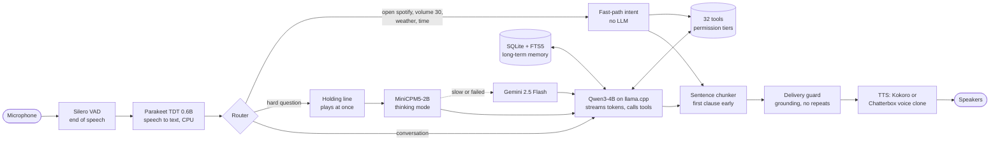

# Ultron: a local, real-time voice assistant

Ultron is a voice assistant that runs **entirely on a Windows gaming laptop**. You talk; it starts answering in about a second. It's fast, it's private, and it runs on a 6 GB laptop GPU.

**It can:**
- control the laptop with 32 permission-gated tools
- remember you between sessions
- hand hard questions to a second reasoning model
- fall back to Gemini only when local models can't help

It speaks in character, as a dry, theatrical AI. It can also clone your own voice.

> **Demo:** _60-second video coming soon_

---

## Highlights

- **~1.1–1.4 s from end of speech to first sound**, with every stage local and streaming. Its cloud-API predecessor took ~2.5 s.
- **137 ms median / 241 ms p95** to the LLM's first sentence, with prompt caching on llama.cpp.
- **Two cooperating local models:**
  - Qwen3-4B answers and talks.
  - MiniCPM5-2B in thinking mode solves the hard ones: 12/12 vs 10/12 on a hard-reasoning set.
  - Gemini 2.5 Flash is the last fallback.
- **Fits a 6 GB GPU and 16 GB of RAM** alongside everyday apps. Tuning llama.cpp cut its RAM from 2.8 GB to 0.75 GB.
- **32 laptop tools** behind a fail-closed permission dispatcher, with audit logging.
- **Long-term memory** in SQLite + FTS5, recalled in ~0.5 ms per turn and learned in the background only when idle.
- **Grounding guardrail:** a sentence that states facts about the user or device that nobody told the model is dropped before it's spoken.
- **Voice cloning** with Chatterbox Turbo, running as an isolated GPU process.
- **374 automated tests.**

## How it works



Every stage overlaps. Speech-to-text runs as soon as the voice detector hears you stop. The LLM streams tokens. The voice starts on the first clause while the model is still writing the rest.

**Three routes per turn:**
1. **Instant commands.** Regex intents run tools with no model call at all.
2. **Hard questions.** A cached holding line plays at once while the reasoning model works. Qwen then voices the verified answer, with the facts intact.
3. **Conversation.** Qwen streams a reply and can call tools mid-turn.

## Measured results

Measured on an RTX 4050 Laptop GPU (6 GB), a Ryzen 7 7840HS and 16 GB of RAM, under Windows 11.

| Model (llama.cpp) | First sentence, cached (p50 / p95) | Laptop commands correct | Memory-extraction recall | RAM / VRAM |
|---|---|---|---|---|
| **Qwen3-4B-Instruct-2507 (GPU)**, chosen | **137 / 241 ms** | **91.7%** | **78%** | 0.78 / 3.1 GB |
| Gemma 4 E4B (GPU) | 251 / 376 ms | 91.7% | 47% | 3.4 / 3.0 GB |
| Hermes-3 3B (GPU) | 211 / 361 ms | 20% | 78% | 1.5 / 2.5 GB |
| Qwen3-4B (CPU) | 991 / 1629 ms | 91.7% | 76% | 2.8 GB / – |
| Qwen3-1.7B (CPU) | 546 / 1180 ms | 21.7% | 51% | 2.4 GB / – |

The final pick was confirmed with a **blind A/B listening test** of the persona.

**Hard-reasoning set** (12 tasks with checkable answers):

| Model | Correct | Median time |
|---|---|---|
| Qwen3-4B | 10/12 | 2.7 s |
| MiniCPM5-2B, thinking mode | **12/12** | 4.0 s |

The thinker loads on demand in 1.6 s.

**Speech:**
- Parakeet int8 on the CPU transcribes 1–3 s utterances in 118–243 ms.
- Kokoro on the GPU renders a first sentence in 387 ms (1,057 ms on the CPU).
- Chatterbox Turbo runs at ~1.4× real time, using 5.8 of 6.1 GB of graphics memory alongside Qwen.

## Features

- **Voice loop:**
  - VAD endpointing that waits longer when you trail off on "and…" or "um…"
  - half-duplex, so it never hears itself; barge-in with headphones
  - per-stage latency shown for every turn
- **Laptop control (32 tools):**
  - **apps:** open, switch, close, from a pre-built Start Menu / Store index
  - **system:** volume, mute, brightness, media keys, window snapping, screenshots, battery, time
  - **files:** find, open, read, move, copy, rename, delete to the Recycle Bin, undo. Home folder only, protected folders refused.
  - **reminders and timers:** natural-language times and repeats. Stored as Task Scheduler jobs, so they fire even while Ultron is off.
  - **weather:** Open-Meteo with caching and retries. Follow-ups keep the place and get direct answers ("Does it rain today?" → "No, I don't think so…").
  - **web:** search, websites, YouTube
- **Safety:**
  - permission tiers SAFE / CONFIRM / BLOCKED / LOCKED
  - unknown tools refused, arguments schema-checked
  - risky actions need a Yes in the window
  - every tool has a timeout, and every call is audit-logged
  - no shutdown, lock or raw input control, by design
- **Memory:**
  - facts and conversation in SQLite (WAL) with FTS5, no cap, nightly backup
  - "what do you know about me" and "forget …"
- **Persona:**
  - reply length adapts: one sentence by default, a real explanation when asked
  - a live clock in every turn
  - an anti-repetition layer
  - signature lines offered only when the topic fits, rotated least-recently-used
  - spoken reactions; real sighs and chuckles with Chatterbox
- **Privacy and control:**
  - local-first: each tool declares whether it uses the cloud
  - the API key lives in Windows Credential Manager
  - the LLM server is bound to localhost
  - **manual on/off only:** one shortcut toggles it, and child processes are tied to a Windows Job Object, so turning off frees the GPU completely. Nothing auto-starts.
- **UI:** a small PyQt6 window with status, a mic toggle, the transcript, a text box and confirmation dialogs.

## Tech stack

- **Core:** Python 3.13 · Windows 11 (Win32 via `ctypes`)
- **LLM serving:**
  - llama.cpp `llama-server` (CUDA) · Qwen3-4B-Instruct-2507 · MiniCPM5-2B
  - OpenAI-compatible streaming API · tool calling · JSON-grammar output · two inference slots
  - Gemini 2.5 Flash (REST, streaming, Google Search grounding)
- **Speech:**
  - sherpa-onnx / ONNX Runtime (CUDA) · Silero VAD · NVIDIA Parakeet TDT 0.6B v3 · Kokoro-82M
  - Chatterbox Turbo on PyTorch 2.6 (CUDA)
- **Audio and UI:** sounddevice · pedalboard · NumPy · PyQt6
- **Data:** SQLite + FTS5 · atomic JSON storage
- **Testing:** `unittest`, with fakes for the model server, tools and voice process

## Project layout

```
ultron/
  core/       voice pipeline, LLM client, routing (brain), delivery guard, TTS/STT, process control
  tools/      tool registry, fail-closed dispatcher, intents, 32 tools in 7 modules
  memory/     SQLite/FTS5 memory, fact extraction, recall, backup
  ui/         PyQt6 window
  lines.py    persona lines and rotation
  persona.py  system prompt and per-turn rules
  voice_server.py   Chatterbox process (runs in its own environment)
scripts/      setup, model downloads, benchmarks, voice recorder
tests/        374 tests
```

## Setup (Windows, NVIDIA GPU)

```powershell
py -3.13 -m venv .venv
.venv\Scripts\python.exe -m pip install -r requirements.txt
scripts\fetch_models.ps1         # llama.cpp + Qwen3-4B + MiniCPM5-2B into models\
scripts\fetch_speech.ps1         # Parakeet, Kokoro, Silero VAD
scripts\install_gpu_speech.ps1   # CUDA build of sherpa-onnx
.venv\Scripts\python.exe scripts\check_env.py
.venv\Scripts\python.exe scripts\set_gemini_key.py   # optional: Gemini fallback (stored in Credential Manager)
scripts\install_shortcuts.ps1    # Desktop + Start menu on/off shortcut
```

**Run it:**
- `.venv\Scripts\python.exe -m ultron` opens the window.
- Add `--text` to type instead of talk.
- Add `--wav clip.wav` to feed a recording and print the latency.

**Your own voice (optional):**
1. Install Chatterbox Turbo into `chatterbox\.venv` (PyTorch 2.6 + CUDA, then `pip install chatterbox-tts`).
2. Record 10–15 s with `scripts\record_voice.py`.
3. Ultron falls back to Kokoro if Chatterbox isn't available.

**Your own signature lines (optional):** put them in `data/signature_lines.json` as `{"naive": {"text": "..."}, ...}`. The keys are listed in `ultron/lines.py`. Without that file, the built-in lines are used.

## Tests

```powershell
.venv\Scripts\python.exe -m unittest discover tests
```

## Status

**Working:**
- the voice loop
- all tools
- memory
- the persona, with the grounding guard
- the window
- the hand-off to the thinker (the Gemini fallback is built and unit-tested; it needs an API key to run)

**Next:**
- wake word ("Ultron", trained on the owner's voice)
- messaging and email tools
- Chatterbox as the default voice, after live tuning

## Credits and licence

- **Licence:** the code is MIT-licensed (see `LICENSE`).
- **How it was built:** with AI-assisted development (Claude Code). I designed the system and chose the models from benchmark data and blind listening tests; the AI wrote much of the code under my direction.

## Models and licences

Model files aren't included; the setup scripts download them. Each model has its own licence. Check each model card before redistributing:
- Qwen3
- MiniCPM
- Kokoro
- Parakeet
- Silero VAD
- Chatterbox (its outputs carry Resemble AI's inaudible watermark)
